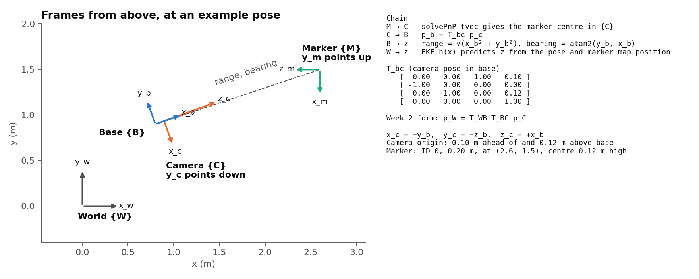
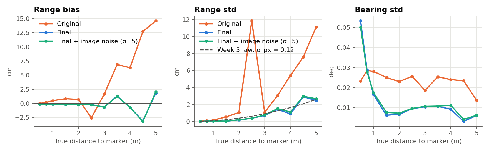
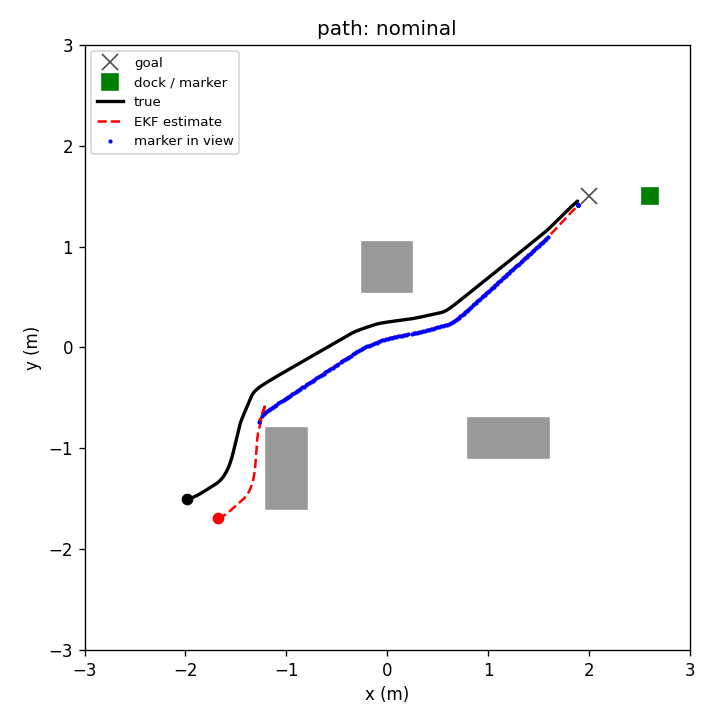
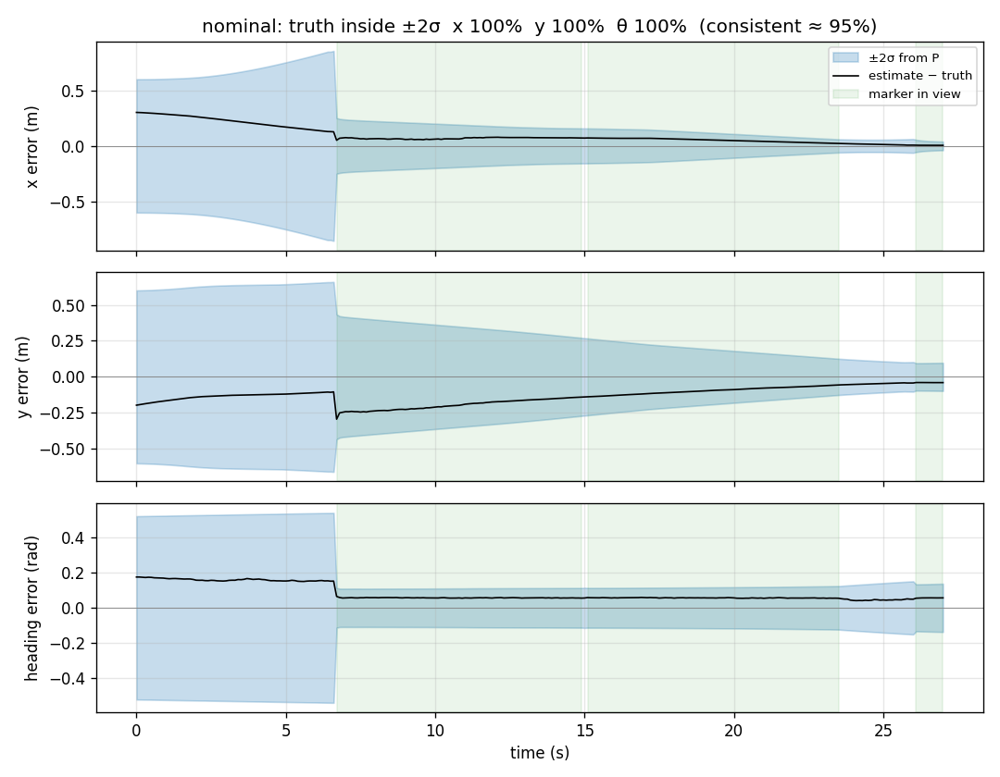

# TurtleBot3 visual docking (41014 Assessment 4, Track A)

A simulated TurtleBot3 Waffle docks at a charging station using only its wheel encoders, a forward camera and a LiDAR. An EKF estimates the robot's pose from odometry and an ArUco marker on the dock, and an LQR controller drives on that estimate. Ground truth is used only for logging and evaluation.

**Group:** 50

| Role | Member | Responsible for |
|---|---|---|
| P1 | Jason | LQR controller and LiDAR obstacle avoidance: `p1_control/` |
| P2 | Senith Kariyawasam | Camera calibration and marker sensing: `p2_sensing/` |
| P3 | Karl Fletcher | EKF, noise tuning, consistency and observability: `p3_estimation/` |
| P4 | Alexis | Scene, main loop, trials and plots: `p4_simulation/`, `main.py` |

**Demo video:** https://youtu.be/f7QrL-bhp3s

**Headline result:** 169 of 190 trial runs docked successfully (19 conditions, 10 seeds each). Ten of the 21 failures are the deliberate no-camera baseline. In the nominal condition all 10 runs dock, in about 27 s, with a final position error of 4.5 ± 0.3 cm. Results vary slightly between computers: see [Limitations](#limitations).

## Install and run

Requires the packages in `requirements.txt` (tested on Python 3.12).

```
pip install -r requirements.txt
python -m p4_simulation.make_scene       # build the scene (run once, or after editing make_scene.py)
python -m p4_simulation.test_drive       # check the sim works -> test_drive.png
python main.py                           # run the full pipeline
python -m p4_simulation.plot_run run_log.npz   # figures -> analysis/fig_*.png
python -m p4_simulation.run_trials       # all 190 trial runs -> analysis/trials_summary.md
```

Press **Space** with the 3D viewer focused to pause or resume. Close the viewer to stop; the log is still saved.

| Option | Effect |
|---|---|
| `--headless` | No windows |
| `--no-ekf` | Dead-reckoning baseline, camera measurements ignored |
| `--seed N` | A different random draw of slip |
| `--push` | A shove mid-run |
| `--blackout` | Marker hidden for 6 s |
| `--record` | Also writes `analysis/camera_pov.mp4` |

No screen or GPU? Prefix commands with `MUJOCO_GL=egl` (NVIDIA) or `MUJOCO_GL=osmesa` (CPU).

## Model and frames

The robot is a TurtleBot3 Waffle simulated in MuJoCo, with wheel radius 0.033 m, wheel separation 0.287 m and a control period of 0.1 s. Motion uses the unicycle model. Process noise is multiplicative per-wheel slip (std 0.02 in the main run).

| Sensor | Details | Used for |
|---|---|---|
| Wheel encoders | Wheel travel per step | EKF predict |
| Camera | 640×480 RGB, 48° vertical FOV, 0.10 m ahead of the base origin, 0.12 m up | EKF update, from the marker's range and bearing |
| LiDAR | 72 rays | Obstacle avoidance |

The marker is ArUco `DICT_4X4_50`, id 0, 0.20 m wide, at (2.6, 1.5) m and facing −x. The robot starts at (−2.0, −1.5, 0) and drives to (2.0, 1.5), just in front of the dock.



W is the fixed world frame. B is the robot base, with x forward, y left and the origin between the wheels. C is the camera, fixed to B. M is the marker, fixed in W at a known position.

`measure()` converts the camera's view of the marker into range and bearing from the base frame, so the camera offset is handled before the EKF.

**One control step:** read the LiDAR and command from the estimate → step the sim → EKF predict from the encoders → detect the marker → EKF update if it was seen. The loop is `run_episode` in `p4_simulation/episode.py`.

## Sensing

The forward camera detects the ArUco marker on the dock, and `solvePnP` gives the marker's position in the camera frame. `measure()` converts this to the base frame with T_bc, then to the range and bearing used by the EKF. If the marker isn't seen it returns `None`, so the EKF only predicts.

**Calibration:** the camera was calibrated from 24 rendered checkerboard images with `CentralCamera.images2C`, with a mean reprojection error of 0.057 px.

| Parameter | Calibrated | Simulator |
|---|---|---|
| fx (px) | 539.12 | 539.05 |
| fy (px) | 539.13 | 539.05 |
| cx (px) | 319.31 | 320.00 |
| cy (px) | 239.59 | 240.00 |

**Range bias:** the first version over-read range by up to 14.6 cm at 5 m. Sub-pixel corner refinement, the calibrated K, the `SOLVEPNP_IPPE_SQUARE` solver and a fitted correction b(r) = 0.00172 r² fixed this. Any marker ID other than 0 is rejected. In a closed-loop run, mean range error fell from +3.2 cm to +1.2 cm, and the worst error from 91.4 cm to 14.0 cm.

**Noise:** range noise grows with distance, following σ_Z = Z²σ_px/(f·s) with σ_px = 0.116 px.

| Distance (m) | Final bias (cm) | Range std (cm) | Bearing std (deg) |
|---|---|---|---|
| 1.0 | -0.13 | 0.07 | 0.017 |
| 2.0 | -0.19 | 0.20 | 0.007 |
| 3.0 | -0.65 | 0.72 | 0.010 |
| 4.0 | -0.75 | 0.90 | 0.009 |
| 5.0 | +1.79 | 2.47 | 0.006 |



**Detection:** detection is at least 90% from 0.5 to 5 m up to a 45° viewing angle. At 0.3 m or closer the marker doesn't fit in the image. The marker must be within about ±30.7° of the camera axis, and it was visible in 68% of steps in the closed-loop run.

**Limitations:** the rendered images have no real sensor noise, so these are best-case values. The range correction is specific to this camera and marker. Full details are in [p2_sensing/notes.md](p2_sensing/notes.md).

## Control

### Modelling

The TurtleBot3 uses a differential drive system, allowing it to move forward and rotate. We used the unicycle model to represent its movement based on its position (x, y), heading (theta), forward velocity (v) and angular velocity (w).

To design the LQR controller, we linearised the model around a straight reference path using two errors. Lateral error (e_y) and heading error (e_theta). The model assumes constant forward speed, small heading errors and minimal wheel slip.

The model was discretised using a time step of 0.1 seconds. Controllability analysis showed that both tracking errors can be controlled through angular velocity when the robot is moving forward (V ≠ 0), as the controllability matrix has a rank of 2.

### Controller design

We implemented an LQR controller to follow reference paths generated by the LiDAR obstacle avoidance system. The controller uses the estimated pose from the EKF to calculate lateral and heading errors before adjusting the robot's angular velocity.

The LQR weights were selected as Q = diag(25, 14.59) and R = 1. These prioritise reducing tracking errors while limiting unnecessary steering. Higher Q values increase tracking responsiveness, while higher R values reduce control effort.

Angular velocity is limited to ±1 rad/s. When heading error exceeds 45 degrees, the robot stops moving forward and rotates towards the reference path before continuing.

The tracking error stayed small during most of the path. Larger errors occurred during some path corrections, particularly when the robot had to change direction to avoid obstacles.

The control effort graph shows that the robot maintained a forward velocity of approximately 0.2 m/s during most of the navigation. Angular velocity varied as the robot corrected its heading and followed the selected path. Several corrections reached the imposed limit of +/- 1 rad/s, showing that steering saturation can restrict how quickly the robot responds to large errors.

### Parameter values

| Value | Setting |
|---|---|
| Discrete model | Ad = [[1, V·Ts], [0, 1]], Bd = [0.5·V·Ts², Ts]ᵀ |
| Ts, cruise speed V | 0.1 s, 0.2 m/s |
| Q | diag(1/0.2², 1/(15°)²) = diag(25, 14.59) |
| R | 1 |
| LQR gain K | [4.08, 3.37] |
| Turn rate limit | ±1 rad/s |
| Turn-on-the-spot threshold | 45° heading error |
| Goal tolerance | 0.15 m |
| LiDAR safe distance | 0.5 m |
| Path half width | 0.25 m |
| Docked when | Facing the marker within 0.05 rad, using the estimate |

### Weight sweep

We tested five weight combinations over three seeds each (means from `analysis/lqr_sweep.csv`). All 15 runs docked. The baseline gave the lowest lateral error, and raising R cut steering effort but raised lateral error to 4.4 cm, which shows the trade-off between accuracy and control effort.

| Weights | Q | R | Success | RMS lateral (cm) | RMS heading (deg) | RMS steering (rad/s) | Saturated (%) |
|---|---|---|---|---|---|---|---|
| Baseline | diag(25, 14.59) | 1 | 3/3 | 2.9 | 7.1 | 0.32 | 5.7 |
| High Q | diag(50, 29.18) | 1 | 3/3 | 3.1 | 7.1 | 0.31 | 6.4 |
| Low Q | diag(12.5, 7.295) | 1 | 3/3 | 3.0 | 7.5 | 0.29 | 3.5 |
| High R | diag(25, 14.59) | 5 | 3/3 | 4.4 | 8.8 | 0.25 | 1.4 |
| Low R | diag(25, 14.59) | 0.2 | 3/3 | 4.0 | 7.1 | 0.34 | 7.5 |

### Control limitations

The controller works well in normal conditions but is less reliable in harder environments. In dense obstacle layouts the robot can become trapped and rotate without finding a clear path, so performance also depends on the obstacle avoidance generating suitable waypoints.

## State estimation (EKF)

The robot estimates its pose with an extended Kalman filter. It predicts from wheel odometry and corrects with the range and bearing to one ArUco marker at a known position.

### State and models

The state is the pose **x** = [x, y, θ]ᵀ in the world frame. The input is **u** = [v, ω]ᵀ, taken from the encoders.

**Motion model** (with step time Δt = 0.1 s, and θ⁺ = θ + ωΔt):

```
x⁺ = x + (v/ω)(sin θ⁺ − sin θ)
y⁺ = y + (v/ω)(cos θ − cos θ⁺)
θ⁺ = θ + ωΔt
```

When |ω| < 10⁻⁶ this becomes straight-line motion: x⁺ = x + vΔt cos θ, y⁺ = y + vΔt sin θ.

**Motion Jacobian:**

```
F = [ 1   0   (v/ω)(cos θ⁺ − cos θ) ]
    [ 0   1   (v/ω)(sin θ⁺ − sin θ) ]
    [ 0   0            1            ]
```

**Measurement model**, for a marker at (mx, my), with dx = mx − x, dy = my − y and q = dx² + dy²:

```
r = √q
b = atan2(dy, dx) − θ
```

**Measurement Jacobian:**

```
H = [ −dx/√q   −dy/√q    0 ]
    [  dy/q    −dx/q    −1 ]
```

**Bearing wrapping:** heading, bearing and the bearing innovation are wrapped to (−π, π] with atan2(sin, cos). Without this, a reading near ±180° would produce an innovation of almost 360°.

### Noise values

| Value | Setting | Reason |
|---|---|---|
| Start offset | 0.3 m, −0.2 m, 10° | Deliberate error, so the filter has to converge. |
| P₀ | diag(0.3², 0.3², (15°)²) | Covers the start offset. |
| Qd | diag(0.005², 0.005², (0.5°)²) | Measured wheel slip is 0.31 mm and 0.109° per step, so this is about 16x and 4.6x larger. The margin is there because of the camera: with a perfect camera the measured value works as well. Chosen on consistency over 30 seeds. |
| Rn | diag(0.06², (0.5°)²) | During runs the range error std is 2.49 cm, and 9% of readings are over 5 cm off (largest 24.1 cm). Bearing stays accurate, so only range was inflated. |

Rn was first set to 2 cm from a static test, which missed these outliers. Across 100 stress runs, 6 cm gave 97 successes against 91. Inflating bearing as well gave 90, and `push_large` fell to 1/10.

### Consistency

If the filter is consistent, NEES averages 3 and about 95% of steps fall below the 95% limit (7.815). Ground truth is used for scoring only, never in the filter.

| Measure (after 10 s) | Seeds 0–9 | Seeds 0–29 |
|---|---|---|
| Mean NEES (ideal 3) | 1.95 | 2.01 |
| Steps under the limit (ideal 95%) | 96.1% | 96.4% |

The filter is consistent and slightly cautious. Mean NIS is far below its ideal of 2 (0.07 after 10 s, seeds 0–9), because Rn has to cover rare large errors and most readings are much better than that.

NEES was needed as well as the ±2σ check. With the measured Qd, about 100% of steps stayed inside ±2σ on each state, but only 31.8% passed NEES. The ±2σ check looks at each state separately, and x and y are strongly correlated (median |ρ| = 0.92), so it misses errors in directions `P` considers unlikely.

### Observability

A single range and bearing marker **cannot** make the full pose observable, even when the robot is moving.

| Case | Rank of observability matrix (3 = full) |
|---|---|
| Stopped, range and bearing | 2 |
| Moving, range and bearing | 2 |
| Moving, if heading were also measured | 3 |
| Wheels only, or marker lost | 0 |

The reason is a symmetry. If the robot's whole path is swung around the marker by any angle, with the heading turned by the same angle, then range, bearing and odometry are all unchanged. The direction n = [−(y − my), x − mx, 1]ᵀ satisfies Hn = 0 at every pose, and F carries it from one step to the next, so no combination of measurements sees it.

Stacking [H; HF; HF²] at a single step gives rank 3, but that is misleading, because H and F change along the path. The rank above uses H and F evaluated along the path over 20-step windows.

Real runs match this result:

- The swing error stays near its start value of 3.5° (3.2–4.1° at the end).
- Swing angle × range matches the final position error to within 0.1 cm on all 10 seeds.
- A perfect camera with the same start error still ends about 4.6 cm off, and with no start error it ends 0.2 cm off.

Docking still works because the swing angle gives less position error at short range.

With wheels only, position sigma grows from 30 cm to about 1 m in 26 s.

### Trial results

All runs use 10 seeds per condition.

| Condition | Success | Final error (cm) | Inside ±2σ x/y/θ (%) |
|---|---|---|---|
| nominal | 10/10 | 4.5 ± 0.3 | 100/100/100 |
| no camera update | 0/10 | 47.4 ± 8.8 | 100/100/100 |
| no start error | 10/10 | 0.2 ± 0.2 | 100/100/100 |
| large start error | 10/10 | 10.1 ± 0.5 | 62/25/36 |
| R 10x smaller | 10/10 | 4.2 ± 0.9 | 100/98/100 |
| R 10x larger | 10/10 | 4.6 ± 0.2 | 100/100/100 |
| Q 10x smaller | 10/10 | 4.4 ± 0.4 | 100/100/100 |
| 8 s marker blackout | 10/10 | 4.5 ± 0.5 | 100/100/100 |
| mid-run push | 10/10 | 4.5 ± 0.4 | 99/100/100 |
| large push | 7/10 | 9.2 ± 2.2 | 91/89/88 |
| slip 0.05 | 10/10 | 4.8 ± 0.8 | 100/100/100 |
| slip 0.10 | 10/10 | 4.5 ± 1.2 | 100/100/99 |
| encoder noise | 10/10 | 4.1 ± 2.4 | 100/100/99 |

- **Camera:** without camera updates the robot never docks correctly, and it ends 32–58° off the marker.
- **Start error:** it causes nearly all of the final error. A large start error still docks, but it is outside the 95% region of P₀ (NEES 9.6), so the ±2σ coverage drops.
- **Tuning:** with R 10x smaller (variance, so std ÷ 3.16), mean NEES rises from 2.01 to 3.98 over 30 seeds. With Q 10x smaller it rises to 5.30. Accuracy barely changes, so these failures only show up in the consistency measures.
- **Large push failures:** two of the three runs (seeds 2 and 5) collide with the estimate 22–24 cm off. With the true pose given to the controller, neither collides, so the estimate is the cause even though the trial table labels them "controller". Seed 1 fails only on the computer that produced the committed results, so it has not been re-tested this way. The final error is about double nominal, which fits the swing part of the push not being correctable.
- **Earlier tuning failure:** with Rn at 2 cm, bad range readings of 10–66 cm made the estimate jump, by up to about 1.5 m in one step, and most collisions followed. Of the 13 collision runs re-tested, 12 no longer collided with the true pose. An outlier-rejection gate was tested and rejected, because it also discards the correct readings after a push (mid-run push fell from 10/10 to 2/10).

### Limitations

- One marker leaves the swing around it unobservable, so heading at docking is about 3–4° off and depends on the start belief. The marker's orientation or a second marker would fix this.
- The filter assumes independent camera errors, but they repeat for a given pose.
- A single Gaussian Rn is a compromise, because most readings are far better than 6 cm and a few are far worse.
- Rn was chosen on the same conditions used to test it, so there is no separate test set.
- The filter can't detect when a push has left `P` too small.
- Results can differ slightly between computers. The committed trials give 169/190. The same code gave 173/190 on a second computer, where `start_B` seeds 0 and 2, `obstacles_dense` seed 2 and `push_large` seed 1 succeed. Repeating the run on that second computer reproduced all 190 final errors exactly, so each computer is repeatable and the difference comes from the machine, most likely small rendering or numerical differences changing the camera readings. We did not isolate the exact cause.

## Results

A run succeeds if the robot believes it has docked and the true range to the marker is under 0.90 m with true bearing within 0.20 rad. Each condition uses seeds 0–9.

| condition | success | time to dock (s) | final err (m) mean ± sd | RMS err (m) | inside ±2σ x/y/θ (%) | failures |
|---|---|---|---|---|---|---|
| nominal | 10/10 | 27.2 | 0.045 ± 0.003 | 0.203 | 100/100/100 | — |
| no_camera_update | 0/10 | nan | 0.474 ± 0.088 | 0.268 | 100/100/100 | 10× model: dead reckoning only — process noise (slip) accumulated with no camera correction |
| start_B | 7/10 | 27.6 | 0.070 ± 0.067 | 0.208 | 100/100/100 | 3× controller: boxed in, spun on the spot until timeout |
| start_C | 10/10 | 29.3 | 0.031 ± 0.013 | 0.165 | 100/92/100 | — |
| init_err_zero | 10/10 | 27.0 | 0.002 ± 0.002 | 0.020 | 100/100/100 | — |
| init_err_large | 10/10 | 28.9 | 0.101 ± 0.005 | 0.445 | 62/25/36 | — |
| slip_0.00 | 10/10 | 27.3 | 0.042 ± 0.000 | 0.200 | 100/100/100 | — |
| slip_0.05 | 10/10 | 27.4 | 0.048 ± 0.008 | 0.207 | 100/100/100 | — |
| slip_0.10 | 10/10 | 27.4 | 0.045 ± 0.012 | 0.203 | 100/100/99 | — |
| obstacles_none | 10/10 | 25.8 | 0.047 ± 0.002 | 0.226 | 100/100/100 | — |
| obstacles_dense | 5/10 | 29.2 | 0.209 ± 0.194 | 0.283 | 100/100/100 | 5× controller: boxed in, spun on the spot until timeout |
| obstacles_shifted | 10/10 | 28.1 | 0.036 ± 0.006 | 0.205 | 98/98/100 | — |
| push_mid_run | 10/10 | 26.6 | 0.045 ± 0.004 | 0.205 | 99/100/100 | — |
| push_large | 7/10 | 23.5 | 0.092 ± 0.022 | 0.232 | 91/89/88 | 3× controller: collision (avoidance did not keep the body clear) |
| marker_blackout | 10/10 | 27.2 | 0.045 ± 0.005 | 0.202 | 100/100/100 | — |
| encoder_noise | 10/10 | 27.5 | 0.041 ± 0.024 | 0.209 | 100/100/99 | — |
| R_10x_smaller | 10/10 | 27.2 | 0.042 ± 0.009 | 0.196 | 100/98/100 | — |
| R_10x_larger | 10/10 | 27.3 | 0.046 ± 0.002 | 0.204 | 100/100/100 | — |
| Q_10x_smaller | 10/10 | 27.3 | 0.044 ± 0.004 | 0.202 | 100/100/100 | — |

Failures by cause:

- **no_camera_update (10):** the deliberate baseline. Dead reckoning cannot correct the error.
- **obstacles_dense (5), start_B (3):** the robot spins on the spot until timeout and never sees the marker. These are controller or scene failures.
- **push_large (3):** the runs collide. Seeds 2 and 5 are caused by the estimate being 22–24 cm off, although the table labels them "controller". See the trial results above.





## Individual contributions

- **Jason:** LQR controller and tuning, LiDAR obstacle avoidance, weight sweep and tracking plots.
- **Senith Kariyawasam:** camera calibration, marker measurement, range-bias correction and noise characterisation.
- **Karl Fletcher:** EKF, noise tuning, consistency and observability checks, and failure diagnosis.
- **Alexis:** simulation scene, main loop, trial runs and plots.

## AI declaration

All group members used Claude to create the project template: the P1, P2, P3 and P4 folder structure, with basic starter files in each to keep us on track. We also used it to clarify and explain topics we did not fully understand, such as how the EKF works.

## Using the simulator

```python
from p4_simulation.tb3sim import TB3Sim

sim = TB3Sim(dt=0.1, slip_std=0.02)
sim.reset(pose=(x, y, yaw))           # optional start pose
sim.step(v, w)                        # speed [m/s], turn rate [rad/s]
dl, dr = sim.odometry()               # wheel travel [m] since last call -> EKF predict
img    = sim.camera()                 # 640x480 RGB -> ArUco -> EKF update
K      = sim.camera_intrinsics()      # camera matrix
T_bc   = sim.T_base_cam()             # camera pose on the robot (4x4)
mk     = sim.marker_xy()              # marker world position
x_true = sim.true_pose()              # GROUND TRUTH — plots/evaluation only
```

**Never use `true_pose()` in the controller or EKF** — it fails the assessment.

## Things to know

- Base frame: x forward, y left, origin between the wheels. The camera is **0.10 m ahead**
  of this, so camera range ≠ robot range (`measure()` handles the conversion).
- Motion uses the unicycle model (`f_uni`, Weeks 7/8); process noise is per-wheel slip.
- Marker: ArUco `DICT_4X4_50`, id 0, 0.20 m, at (2.6, 1.5) facing −x.
- Robot: Waffle — wheel radius 0.033 m, separation 0.287 m.
- Don't hand-edit `tb3_scene.xml`; change `make_scene.py` and re-run it.
