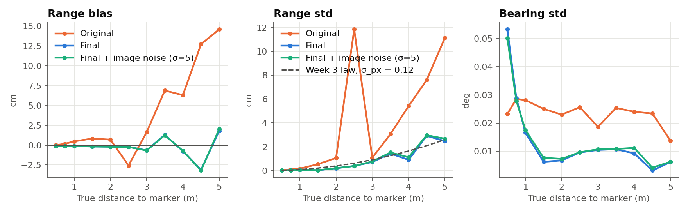
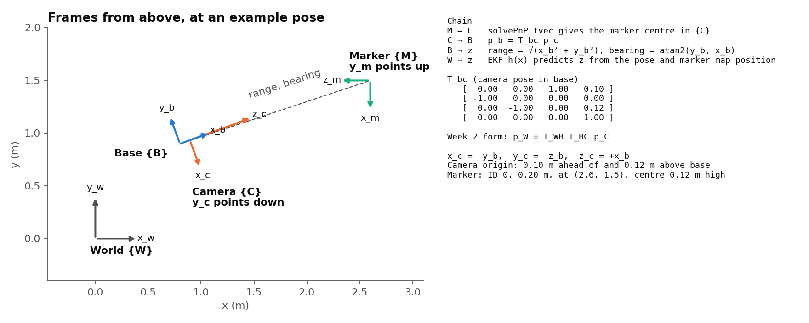
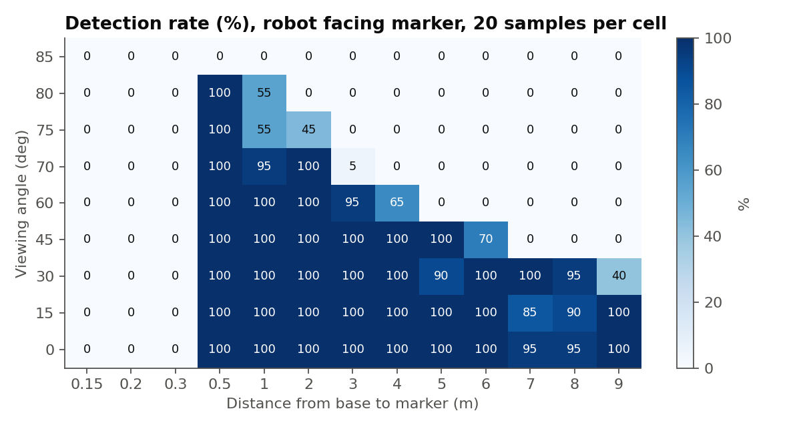

# P2: Sensing

## Overview

The robot's forward camera detects the ArUco marker (ID 0, 0.20 m) on the dock, and solvePnP gives the marker's position in the camera frame. This is converted to the base frame using T_bc, then to the range and bearing used by the EKF.

## How to run

```bash
python -m p2_sensing.Calibrate
python -m p2_sensing.Characterise
```

`Calibrate` writes `camera_calib.json` and `calib_images/`. `Characterise` writes the plots and tables to `results/`. `Calibrate` needs the Week 3 toolbox:

```bash
pip install --no-deps machinevision-toolbox-python mvtb-data ansitable pgraph-python spatialmath-python
pip install "scipy<1.15" tqdm requests
```

## Calibration

We calibrated the camera from 24 rendered checkerboard images using `CentralCamera.images2C`, with a mean reprojection error of 0.057 px (worst image 0.079 px).

| Parameter | Calibrated | Simulator | Half-set difference |
|---|---|---|---|
| fx (px) | 539.12 | 539.05 | 0.06 |
| fy (px) | 539.13 | 539.05 | 0.12 |
| cx (px) | 319.31 | 320.00 | 0.08 |
| cy (px) | 239.59 | 240.00 | 0.13 |

The focal lengths closely match the simulator. The distortion coefficients are small, as expected for a simulator with no distortion, so `measure()` does not apply them.

## Range bias

The original measurement over-read range, by up to 14.6 cm at 5 m. Detected corners were not refined, so the marker's measured side was often up to 1 px short and the marker appeared too far away. We made these changes:

- Added sub-pixel corner refinement
- Used the calibrated K
- Used the `SOLVEPNP_IPPE_SQUARE` solver
- Removed the remaining error with a fitted correction, b(r) = 0.00172 r²
- Rejected any marker ID other than 0, because misread IDs caused large errors

The correction was fitted offline against simulator ground truth, like measuring with a tape on a real robot. The running pipeline only reads the saved value.

In a closed-loop run, mean range error fell from +3.2 cm to +1.2 cm, and the worst error fell from 91.4 cm to 14.0 cm.

## Noise

Each distance used 50 samples with small pose changes, because identical poses render identical images. The spread is therefore mostly pixel-level corner error.

| Distance (m) | Original bias (cm) | Final bias (cm) | Final range std (cm) | Final bearing std (deg) |
|---|---|---|---|---|
| 1.0 | +0.48 | -0.13 | 0.07 | 0.017 |
| 2.0 | +0.70 | -0.19 | 0.20 | 0.007 |
| 3.0 | +1.63 | -0.65 | 0.72 | 0.010 |
| 4.0 | +6.31 | -0.75 | 0.90 | 0.009 |
| 5.0 | +14.59 | +1.79 | 2.47 | 0.006 |

Range noise grows with distance, following the Week 3 law σ_Z = Z²σ_px/(f·s) with σ_px = 0.116 px. Adding image noise (σ = 5 grey levels) changed the results very little. RMS error in the closed-loop run was 3.14 cm in range and 0.018° in bearing.



## Frames

A measurement passes through marker → camera → base. `solvePnP` gives the marker centre in the camera frame, and p_b = T_bc p_c converts it to the base frame. The camera sits 0.10 m ahead of and 0.12 m above the base, with x_c = -y_b, y_c = -z_b and z_c = +x_b. Leaving out the T_bc translation caused a -9.8 cm range bias, against +0.04 cm with the full chain.



## Detection and marker loss

With the robot facing the marker and walls and obstacles hidden, detection was at least 90% from 0.5 to 5 m up to a 45° viewing angle. It falls at steeper angles, and the marker was never detected at 85°. At 0.3 m or closer, the marker does not fit in the image. The horizontal field of view is 61.4°, so the marker must be within about ±30.7° of the camera axis.

When the marker is lost, `measure()` returns `None`, so the EKF only predicts and its uncertainty grows. In the closed-loop run, the marker was visible in 68% of steps. During the longest loss, the first 6.7 s of the run, σx grew from 30 cm to 42 cm.



## Design decisions

- **OpenCV instead of `fiducial()`:** `measure()` uses the same detector and solver as the Week 3 `Image.fiducial()`, because `fiducial()` has no sub-pixel setting. It also crashed on 14 of 150 frames in a quick test. That test script is not in this repo.
- **Tried and rejected:** `cv2.cornerSubPix` with a fixed 5×5 window on the detected corners gave range errors of about -44 cm at 3–5 m.

## Limitations

- The rendered images have no real sensor noise, so these figures are best-case values for this simulator.
- The range correction is specific to this camera and marker.
- Errors of a few centimetres remain beyond 4 m.
- P3's notes list a 19.95 cm range error at 1.38 m from before calibration. This has not been rechecked.